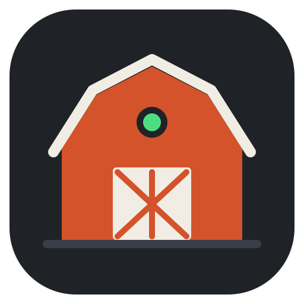
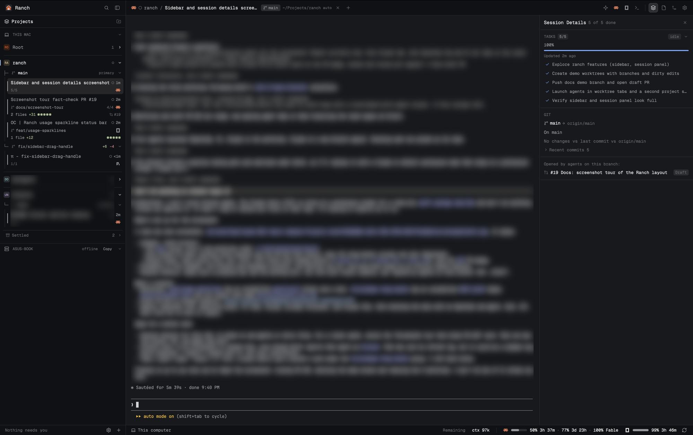

<p align="center">
  
</p>

<h1 align="center">Ranch</h1>

<p align="center">
  A <a href="https://herdr.dev">Herdr</a> layout for agent-heavy work.<br>
  See every coding agent's status, tasks, git state and pull request without opening its terminal.
</p>



Ranch is a layout plus ten mods for the Herdr app. It puts a projects sidebar of agent session cards on the left, a top bar for the current tab above the terminal panes, a right-hand panel stack (session details, files, changes, settings) and a status bar with agent usage limits and a resource manager along the bottom.

It works with **Claude Code, Codex, OpenCode, Pi and Antigravity**, on this computer and on remote Herdr machines. An optional task-reporting bridge (`ranch-tasks`) lets agents publish their plan, so the UI can show what each one is doing as it works.

- **Requires:** herdr-app ≥ 0.1.15, herdr-core (`hc`) ≥ 0.1.20, Node.js (for task reporting and usage helpers), `git`. `gh` (authenticated) is optional and turns on the PR features.
- **Spec:** [`RECIPE.md`](RECIPE.md) is the full layout recipe (sizes, behaviours, limits). [`requirements.md`](requirements.md) is the design spec.

---

## Contents

- [Features](#features)
- [Layout](#layout)
- [Mods](#mods)
- [Keyboard shortcuts](#keyboard-shortcuts)
- [Install](#install)
- [Task reporting (`ranch-tasks`)](#task-reporting-ranch-tasks)
- [Updating](#updating)
- [Development](#development)
- [Repository layout](#repository-layout)
- [Privacy](#privacy)
- [Credits and licences](#credits-and-licences)

---

## Features

- **One glance at all your agents.** The sidebar groups session cards by machine → space → git checkout. Each card shows the status (working / needs you / done / idle), branch, task progress, diff stats and PR number.
- **"Needs you" first.** Blocked agents pulse, move to the front of the attention queue, and are one shortcut (`⌘⌥J`) away.
- **Session details.** Live task list, sub-agents, git state (ahead/behind, changed files, recent commits) and PR status with reviews and CI checks.
- **Worktree workflow.** The start-agent and new-space dialogs create `git worktree`s under `~/.herdr/worktrees/<repo>/<branch>` and open a space in them, on local or remote machines.
- **Smart tab names.** Tabs are named from the agent's session title, first prompt or branch. Your own renames always win.
- **Usage limits.** The status bar shows each installed agent's rate-limit windows (Claude, Codex, Copilot, OpenCode Go, Antigravity), read only through each agent's own CLI.
- **Resource manager.** Memory and CPU per space, tab and terminal, orphaned terminals, listening ports. You can end processes from here.
- **Remote machines.** Remote spaces, folders, git and task stores work the same way as local ones.
- **Self-update.** Check for and apply updates from the settings panel.

## Layout

```
┌──────────────┬─────────────────────────────────────────────────────────┐
│ brand        │ top bar: current tab · attention · launchers · panels   │
├──────────────┼──────────────────────────────────────┬──────────────────┤
│              │                                      │ panel stack      │
│ projects     │                                      │  ├ session       │
│ tree         │        terminal panes (active tab)   │  ├ files         │
│ (machines →  │                                      │  ├ changes       │
│  spaces →    │                                      │  └ settings      │
│  sessions)   │                                      │ (hidden default) │
├──────────────┴──────────────────────────────────────┴──────────────────┤
│ usage meter                                  resources · ports · hosts │
└────────────────────────────────────────────────────────────────────────┘
```

Defined in [`layouts/ranch.json`](layouts/ranch.json), preview art in [`layouts/ranch.svg`](layouts/ranch.svg).

| Region | Block | Mod | Size |
| --- | --- | --- | --- |
| Sidebar brand header | `brand` | `ranch-chrome` | 42px, window drag |
| Projects tree | `tree` | `ranch-sidebar` | sidebar 268px (44–480), collapses to a rail |
| Top bar | `tabs` | `ranch-topbar` | 42px, window drag |
| Terminal panes | `main` | (Herdr active tab) | fills |
| Right panel | `panel-body` stack | `ranch-session`, `ranch-files`, `ranch-changes`, `ranch-settings` | 360px (280–640), hidden by default |
| Status bar, left | `usage` | `ranch-usage` | 28px row |
| Status bar, right | `status` | `ranch-chrome` (`{status: true}`) | 28px row |

Dialogs (`ranch-launch`, `ranch-newspace`) don't have a layout block. They open as popups.

## Mods

Every mod lives in `mods/ranch-*/` and is `place: "none"`. Ranch places them only through its layout.

| Mod | What it does |
| --- | --- |
| [`ranch-chrome`](mods/ranch-chrome) | Brand header (logo, space search, sidebar collapse) and the right side of the status bar: the **Resource Manager** popover (memory and CPU per terminal, orphans, ports, end processes), terminal count, ports and hosts. |
| [`ranch-sidebar`](mods/ranch-sidebar) | The projects tree: machines → spaces → git checkouts/worktrees → session cards, with status, branch, diff and PR. Folders are kept after their last session closes. Includes drag reordering, settled-tab groups, status filters, j/k keyboard navigation, and the **tab namer** (`namer.js`), which publishes `ranch.activity`. |
| [`ranch-topbar`](mods/ranch-topbar) | Current tab (icon, status, space / tab name, branch, cwd), attention pill, agent launchers, and panel toggles. The last open panel is remembered per space. |
| [`ranch-session`](mods/ranch-session) | Session Details panel: Tasks, Sub-agents, Git and PR cards, plus Shell / Editor / Copy branch / Push / PR actions. |
| [`ranch-files`](mods/ranch-files) | Read-only file browser. A restyled clone of Herdr 0.1.15's `files` mod. |
| [`ranch-changes`](mods/ranch-changes) | Git diff viewer with history and stashes. A restyled clone of Herdr 0.1.15's `changes` mod. |
| [`ranch-settings`](mods/ranch-settings) | All Ranch settings: top-bar agents, card and panel toggles, refresh intervals, tab naming, status-bar items, task-reporting health and setup per machine, and updates. |
| [`ranch-launch`](mods/ranch-launch) | **Start agent** dialog (`⌘⌥N`): prompt, agent picker, and an optional new worktree and branch. |
| [`ranch-newspace`](mods/ranch-newspace) | **New space** dialog: machine, folder (with a remote-aware folder browser), worktree and branch. |
| [`ranch-usage`](mods/ranch-usage) | Usage meter for agent rate limits, with a hover panel and display preferences. Adapted from Orca's usage-limits mod. |

The Herdr mods `picker`, `new-menu`, `menu`, `confirm` and `machine-add` are used as they ship.

Shared code lives in [`lib/`](lib). Herdr mods can't import from outside their own folder, so `scripts/sync-lib.sh` copies into each `mods/ranch-*/lib/` only the `lib/*.js` files that mod imports (and what those import), and deletes copies it no longer needs. **Edit `lib/`, never the copies.**

## Keyboard shortcuts

From [`keys.json`](keys.json) (layout `ranch`). Use `Ctrl+Alt` instead of `⌘⌥` on Windows/Linux.

| Keys | Action |
| --- | --- |
| `⌘⌥1` / `2` / `3` / `4` | Toggle the Session / Files / Changes / Settings panel |
| `⌘⌥J` | Jump to the next blocked or done tab |
| `⌘⌥N` | Open the Start-agent dialog |

With the sidebar focused: `j`/`k` or arrows to move, `Enter` to select, `→` to switch to the pane, `x` to settle or unsettle, `p` to peek the agent, `c` to copy the branch.

> On Windows, `Ctrl+Alt+<key>` is AltGr on many keyboard layouts. If it clashes with typing characters, rebind to `ctrl-shift-alt-*` in `keys.json`.

## Install

### From herdr.dev

Install Ranch from [herdr.dev/layouts](https://herdr.dev/layouts). Herdr's install agent follows [`RECIPE.md`](RECIPE.md). Then switch to it:

```sh
herdr-app do layout.switch --name ranch
```

### Manually

```sh
git clone https://github.com/Ramanan-Bala/herdr-ranch.git
cd herdr-ranch
HERDR=${HERDR_APP_HOME:-$HOME/.config/herdr-app}

sh scripts/sync-lib.sh                       # copy the lib/ files each mod uses (needs node)
cp layouts/ranch.json layouts/ranch.svg "$HERDR/layouts/"
cp -R mods/ranch-* "$HERDR/mods/"
# merge the "layout:ranch" block from keys.json into $HERDR/keys.json

herdr-app do layout.switch --name ranch
```

Then turn on task reporting (next section). You can run it from the shell, or click **Set up** in the Ranch settings panel.

## Task reporting (`ranch-tasks`)

Herdr already knows whether an agent is working or blocked. The tasks, session titles, sub-agents and PRs come from the bridge, which writes one JSON store per terminal to `~/.herdr/ranch/tasks/<terminal>.json`.

```sh
node bin/ranch-tasks install          # shows which files it will change, then asks
node bin/ranch-tasks install --yes    # no prompt
~/.herdr/ranch/bin/ranch-tasks status # per-agent install state (--json available)
~/.herdr/ranch/bin/ranch-tasks uninstall
~/.herdr/ranch/bin/ranch-tasks gc     # remove stores for terminals that no longer exist
```

`install` copies itself to `~/.herdr/ranch/bin/`. The launcher finds Node on its own, so it works with nvm, volta or Homebrew. It then wires up each agent it finds:

| Agent | What gets installed |
| --- | --- |
| Claude Code | Hooks in `~/.claude/settings.json`, rules in `~/.claude/RANCH.md` (imported from `CLAUDE.md`) |
| Codex | Hooks in `~/.codex/hooks.json`, rules in `~/.codex/AGENTS.md`. Trust them once with `/hooks`. |
| OpenCode | Plugin `~/.config/opencode/plugins/ranch-tasks.js`, rules in `AGENTS.md`, and `"experimental": { "todo": true }` |
| Pi | Extension `~/.pi/agent/extensions/ranch-tasks.js`, rules in `AGENTS.md`, plus optional OpenCode themes and a status line |
| Antigravity | A Ranch-owned `agy` plugin in `~/.gemini/config/plugins/ranch-tasks/` |

All of it can be undone. Every edited file is backed up to `~/.herdr/ranch/backups/`, everything created is recorded in `~/.herdr/ranch/install.json`, and `uninstall` puts it all back. Hooks never print to the agent's context. Errors go to `~/.herdr/ranch/logs/adapter.log`.

**Remote machines:** agents on a remote machine report only if the bridge is installed there too. With a remote space showing, click **Set up** in Settings or Session Details. This copies the bridge over `hc exec` and installs it (needs `sh` and `tar` on both machines).

Codex and OpenCode each have setup caveats (the Codex `update_plan` tool, sandbox writable roots, OpenCode `--standalone`). See [`RECIPE.md`](RECIPE.md) for details.

## Updating

Open the **Updates** card in Ranch settings and use **Check now** / **Update**, or run:

```sh
~/.herdr/ranch/bin/ranch-tasks update check
~/.herdr/ranch/bin/ranch-tasks update --yes
```

The updater shallow-clones `main` into `~/.herdr/ranch/src` and replaces `layouts/ranch.*` and `mods/ranch-*`. It backs up any files you edited first, and re-runs task-reporting install if you have it. It never touches `keys.json`. If you use the symlinked dev install, update with `git pull` instead.

## Development

```sh
npm run reload   # symlink layout + mods into Herdr and reload Ranch
sh scripts/link-dev.sh --unlink   # undo the dev links

npm test         # sync lib/ and run node --test test/*.test.js
npm run check    # sync lib/, herdr-app check every mod, validate JSON
npm run verify   # both
```

Without a POSIX shell, run `node scripts/check.mjs`.

Things to know when writing mods (more under "Watch out" in [`RECIPE.md`](RECIPE.md)):

- Mod code uses gpui-kit, not the DOM. There is no CSS and no `setTimeout`, so use `cx.timer` / `cx.spawn`. Colours come only from `theme()` tokens.
- Anything clickable or hoverable needs a unique `.id(...)`. Controls inside `window_drag` areas must `cx.stop_propagation()` on left mouse-down.
- `herdr-app check` doesn't run render paths. Test a real build too.
- Herdr doesn't hot-reload mods through symlinks. `npm run reload` switches layouts away and back to reload them.

## Repository layout

```
layouts/          ranch.json layout + ranch.svg preview
mods/ranch-*/     the ten Ranch mods (each with a synced lib/ copy)
lib/              shared source for mods (git, tasks, naming, settings, sysstats, …)
adapters/         ranch-tasks: CLI, installer, per-agent hooks/plugins, updater
bin/ranch-tasks   task-reporting entry point
scripts/          sync-lib, check, link-dev
test/             node:test suites and hook fixtures
assets/logo/      Ranch logo and mark
keys.json         ranch layout shortcuts
RECIPE.md         full layout recipe (herdr.dev format)
requirements.md   design spec
```

## Privacy

Ranch runs `git`, `gh`, `sh`, `hc`, and, only if you enable model tab names, `claude`. It reads `~/.herdr/ranch/tasks/`. It goes on the network only through `gh`, through `git` to this repository for updates, and through each agent's own CLI for usage limits. It reads no tokens and sends no telemetry.

## Credits and licences

- The usage meter (`mods/ranch-usage`) is adapted from [Orca](https://github.com/VladTemp27/herdr-orca)'s usage-limits mod (Apache-2.0). See [`THIRD_PARTY.md`](THIRD_PARTY.md), [`licenses/herdr-orca/`](licenses/herdr-orca) and [`mods/ranch-usage/CHANGES.md`](mods/ranch-usage/CHANGES.md).
- `ranch-files` and `ranch-changes` are clones of Herdr 0.1.15's shipped `files` and `changes` mods.
