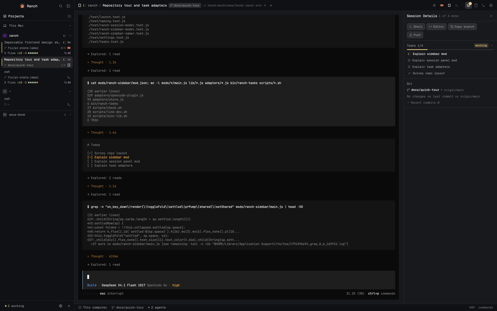

# Ranch

Ranch is a layout for Herdr: a project sidebar of agent session cards on the left, a top bar with the current tab and quick controls above the terminal panes, and a right panel stack with session details, files, changes and settings. It adds smart tab naming and an opt-in task-reporting bridge so the sidebar and panels show what each agent is doing — tasks, git state, pull requests — while it works.

**What you see:** Left to right:

- **Sidebar** (268px default, resizable 44–480, background `chrome`), three regions:
  - Brand header, 46px tall, window-drag area: `mods/ranch-chrome/logo.svg` at 20px, "Ranch" 13.5px semibold, a search icon (15px) that opens the space picker, and a sidebar-toggle icon that collapses to a compact rail (76px on macOS, 44px elsewhere; restores the last width, default 268). Under 160px wide the whole sidebar becomes the rail: one 28px cell per space with its initial, a status dot, and an expand chevron.
  - Projects tree (`mods/ranch-sidebar`): machine headers (30px, only shown with more than one machine: a 13px laptop icon for this computer or server icon for a remote one in the 17px badge column, name 11.5px semibold `t.muted`, "connecting…" / "offline" states, blocked badge, Copy login button for unavailable machines, a fold chevron at the far right and, when folded, the number of spaces; every machine after the first has a 1px `t.border` line above it), then space rows (28px, 10px above, initials badge 17px, name, + and sparkle buttons that appear only on hover, status ring, folded card count, a chevron indicator at the far right in the same column as the machine chevrons — clicking anywhere on the row folds or unfolds it, the chevron is not a separate button; for a git space the folded ring and count cover the main checkout and its worktrees; the branch label, +/− diff and PR badge no longer sit on the space row), then for a git space one compact 24px row per checkout — the main checkout first, tagged "primary", then each linked worktree — (a ├─/└─ tree glyph, a 10px git-branch icon, the branch name 11px semibold, a small dim "primary" tag on the main checkout's row, the same +/− diff and PR badge, plus/sparkle on hover and a fold chevron; a folded worktree shows its status ring and "Needs you" or the card count; folding a main space hides its worktree rows too) with its session cards indented under the row behind a 1px `t.border` guide line (non-git spaces keep their session cards directly under the space row), then session cards with 6px between them. A card is 58px tall with three lines, 44px with two, 30px with only the title line (cards under a git space whose pane belongs to the checkout drop the branch and diff/PR lines): line 1 title 12px semibold + status chip (ring + relative time) + hover actions (peek, copy branch, settle, close — 18px icon buttons); line 2 git-branch icon + branch name 10px, task progress "3/7", agent icon; line 3 "N files" +N −N, five 6px diff squares, PR "#123" link. A 2px status bar runs down the card's left edge (idle `t.muted`, working `t.ansi3`, blocked `t.ansi1`, done `t.ansi4`). Selected card gets `t.selected`, keyboard highlight a 1px `t.accent` border. Settled tabs gather in one machine-level section after the machine's last space: a 26px "Settled" row (archive icon on the cards' text column, count and chevron in the right-hand chevron column, 1px `t.border` line above like the machine separators) folds the machine's whole settled group; its cards keep their own branch/folder line prefixed by the dim space name, so each shows where it lives. Every fold (machine, space, worktree, settled) redraws at once.
  - Footer, 40px: status chips 20px tall, 11.5px text — "N needs you" (`t.blocked`, pulsing 6px dot), "N working" (`t.working`), "N done" (`t.done`), "N idle" as tooltip only. Quiet state is dim "Nothing needs you".
- **Work column** (right of a 1px `border` divider):
  - Top bar, 42px tall, window-drag (`mods/ranch-topbar`, background `chrome`): macOS traffic-light padding, then the current tab — program icon 15px, status glyph (12px spinner when working, 7px blocked dot, 12px check when done, 9px idle ring), space name (muted, max 160px), "/", tab name (semibold, max 260px), branch pill (18px tall, `t.raised`, git-branch icon), cwd (dim, max 240px), an "auto" marker when the agent named the tab or a "✎" when you did, close button. Then the attention pill (24px tall, "N needs you · M done"), a sparkle button, one launcher per configured agent, and four panel-toggle buttons (Session, Files, Changes, Settings — 26px, open one highlighted). Each control's tooltip names its shortcut ("⌘⌥1", or "Ctrl+Alt+1" off macOS).
  - Terminal panes: one `main` block showing the active tab (`tab: "active"`, pane gap 1, radius 0, background `background`).
  - Right panel, hidden by default: column 360px default, resizable 280–640, holding a `panel-body` stack with four blocks — session, files, changes, settings. One visible at a time; the last-open panel is remembered per space.
  - **Status row, 28px** (`mods/ranch-usage` left, shipped `workspace-status` right): the usage meter reads every installed agent's limit windows — provider icon, then compact numbers ("5h 21% · wk 3%") with a small bar per window when there's room, led by a dim "Used" label. Numbers wear their level: plain `t.foreground` when ok (dim "—" for a window that has reset), `t.ansi3` at ≥70% used, `t.ansi1` at ≥90%. Hovering the meter opens a panel with each provider's plan pill, last-reading age, per-window 96px bars and time to reset, the focused session's numbers (context %, calls, compactions), and a "Not reported by its CLI" section listing installed agents whose CLI cannot report usage with an "Open usage ↗" link (hidden when there are none); ⚙ opens checkboxes for what the bar shows. Data comes only from each agent's own CLI (claude, codex, gh for Copilot, and opencode for OpenCode Go — the CLIs authenticate themselves, no tokens are read), fetched every 5 minutes, with a refresh button on a 30s cooldown. Agents whose CLI is not installed stay out of the bar entirely.
- **Session Details panel** (`mods/ranch-session`): header 40px "Session Details" + "N of M done" subtitle + close; agent picker chips when the tab has several agents; action bar with Shell / Editor / Copy branch / Push / PR buttons (26px); then cards separated by 1px `t.border` lines: Tasks ("Tasks N/M", status pill, 3px progress bar, task rows with spinner/ring/check icons), Sub-agents (Herdr sub-terminals with Peek / Keep-as-tab actions, plus parsed sub-agents from the store, read-only), Git (branch, ahead/behind counts, "N files +A −D vs <ref>" with an expandable list capped at 20 files, recent-commits list capped at 5, persisted open/closed), and PR (state pill reading Open / Draft / Merged / Closed in `ansi2` green / `dim` / `ansi5` purple / `blocked` red, a PR icon in the same colour centred on the title's first line, a wrapping byline "by · into · updated", review and "Behind base" pills, "Approved by …" in `t.done`, "Waiting on …", a CI checks list with fail/pending/pass/skipped glyphs, failed checks open expanded). The sidebar card's `#PR` link uses the same state colours, with the state in its tooltip.
- **Files and Changes panels**: Ranch's clones of Herdr 0.1.15's `files` and `changes` mods, restyled as flat panels (`t.surface`, no rounded card border). Files is a lazy read-only browser (500 files per folder, 5,000 total) with bounded previews; Changes is a git diff viewer with a virtual list.
- **Start-agent dialog** (`mods/ranch-launch`): 520×256, opened from the sparkle button or ⌘⌥N. One input ("What should it do? (optional)"), agent chips 28px tall, a worktree checkbox that appears inside a git repo, and a branch field prefilled from the prompt.
- **Ranch settings panel** (`mods/ranch-settings`): sections for top-bar agents (reorderable, removable), sidebar card switches (time, diff stats, PR link), session-details switches (tasks, git, commits, sub-agents), refresh steppers (remote git 5–300s, default 15; pull request 30–900s, default 120), smart tab names (enabled, on-exit behaviour Keep name / Revert / Add ✓, follow agent renames, optional model summary, max length 16–60 default 32), task reporting (`ranch-tasks status` per agent: installed `t.done` / outdated `t.working` / broken or missing `t.blocked`, with a Set up button — "Repair" while any agent is broken), and health (git, gh auth state, herdr-app version vs minimum 0.1.15).

**How it behaves:** Agent statuses everywhere come from Herdr's tab status when the agent runs in a Herdr terminal, otherwise from the agent's task-store activity:

- **Working**: yellow (`t.working`, left bar `t.ansi3`). Sidebar card and top bar show an 11–12px spinner SVG spinning over 900ms; task card shows per-task spinners for in-progress tasks; the task progress bar fills `t.working` while any task is in progress.
- **Blocked**: red (`t.blocked`, left bar `t.ansi1`), always labelled "Needs you". The card dot, footer chip dot and attention pill dot pulse (opacity 0.35→1, 1200ms loop). Blocked tabs jump to the front of the attention queue; clicking the attention pill or footer chip focuses the next blocked agent.
- **Done**: blue (`t.done`, left bar `t.ansi4`), check icon in card, tab and task rows.
- **Idle**: hollow dim ring, left bar `t.muted`; in the footer it appears only as a tooltip count.
- **None**: an agent with no Herdr status and no store activity counts as idle; an agent with store activity older than 30 minutes reads as idle.

Clicks: cards and chips focus tabs (space.select + tab.select); clicking a space row folds or unfolds it (its worktrees and cards with it); hover actions peek the agent's terminal, copy the branch, settle/unsettle the tab, or close it (confirm dialog when working/blocked); footer chips filter the tree by status (blocked chip focuses instead); PR links and branch/commit/check links open in the browser; a Files row click switches the panel stack to Changes. Keys: ⌘⌥1–4 (Ctrl+Alt on Windows/Linux) toggle the session/files/changes/settings panels, ⌘⌥J jumps to the next blocked or done tab, ⌘⌥N opens the Start-agent dialog. With the sidebar focused: j/k or arrows move the card highlight, Enter selects, Right switches to the pane, x settles/unsettles, p peeks the primary agent, c copies the branch. In the dialog: Enter starts, ↑/↓ cycles the agent, Esc closes. Double-clicking a tab name renames it; the top bar scrolls between tabs with the wheel.

Tab names: the agent names its tab once it has a title, first prompt or branch (highest non-locked source wins; generic names like a bare terminal id "t11" are rejected; optional 5s model summary via `claude -p --model haiku` off by default). Renaming the tab yourself locks it from then on; on exit the name keeps, resets, or gets a ✓ depending on settings. Renaming never touches the agent's own session title.

Tasks are read-only in the UI. Agents report them through the task-reporting bridge (see Built from); Ranch never sends anything to the agent.

**Built from:**

- **Layout** (`layouts/ranch.json`): root row, no titlebar, traffic lights at [12,16], background `canvas`, terminal_padding [14,12], 1px `border` dividers, ui_font "Geist Mono", preview "layouts/ranch.svg". Tree: `sidebar` column (268px, min 44, max 480, resizable, `chrome`) → `brand` block (46px, window_drag) → mod `ranch-chrome`; `tree` block → `ranch-sidebar`; `sidebar-footer` block (40px) → `ranch-chrome` with props `{footer: true}`. Then `work` column → `tabs` block (42px, window_drag) → `ranch-topbar`; `work-body` row (gap 0, divider 1/border) → `main` block (tab "active", pane {gap 1, radius 0, background "background", lone false}, background `border`) and `panel` column (hidden, 360px, min 280, max 640) → `panel-body` stack (active "session") with blocks `session`→`ranch-session`, `files`→`ranch-files`, `changes`→`ranch-changes`, `settings`→`ranch-settings`; then `status-row` (28px, not resizable) → `usage` block (weight 1, min 130) → mod `ranch-usage` (props `{align: "left", showRemaining: false}`) and `status` block (weight 1) → shipped mod `workspace-status`.
- **Keys** (`keys.json`, layout `ranch`): cmd-alt-1/2/3/4 and ctrl-alt-1/2/3/4 → `ranch-topbar.panel:session|files|changes|settings`; cmd-alt-j and ctrl-alt-j → `ranch-topbar.attention:next`; cmd-alt-n and ctrl-alt-n → `ranch-topbar.launch`. Windows: `ctrl-alt-*` is AltGr on many layouts and clashes with `@`, `{` and `€`, so Windows users may prefer rebinding the ctrl-alt shortcuts to `ctrl-shift-alt-*` in `keys.json` — the shipped defaults are unchanged.
- **Mods** (all `place: "none"`; sidebar, session and settings are `focusable: true`):
  - `ranch-chrome` — brand header and footer. Chips count agent tabs per space using `lib/format.js` status helpers over `shared("ranch.activity")`; the search button opens the shipped picker via `mod.open`; the toggle resizes the sidebar via `layout.resize`.
  - `ranch-sidebar` (+ `model.js` pure tree builder, `namer.js` + `namer-model.js` tab namer) — the tree. Git facts come from `git rev-parse` / `status --porcelain` / `diff --shortstat` against the merge-base with the default branch; PR data from `gh pr view` through a 120s TTL cache and a queue run in batches of 4; local repos are watched with `watchFolder` (1s debounce), remote machines polled (remote git default 15s, floor 5s). Focus keys j/k/enter/x/p/c handled in `on_key_down`. The namer runs a 2s tick, reads each agent's task store, publishes `shared("ranch.activity")` and renames tabs through `tab.rename` with source-ranking and debounce rules from `lib/naming.js`; user-locked tabs keep recording candidates so Reset snaps straight back.
  - `ranch-topbar` — tab strip, attention pill, launchers, panel toggles; remembers the per-space panel in localStorage; refreshes known agents every 60s; wheel scrolls tabs; right-click opens the shipped `menu` with close/rename actions (close of a busy tab goes through shipped `confirm`).
  - `ranch-session` (+ `model.js`) — session details; reads the agent's task store (`~/.herdr/ranch/tasks/<terminal>.json`), falls back to `ranch-tasks status --json` when the store is missing; polls git (30s local, remote per settings) and gh PRs (default 120s); watches the local tasks dir; publishes the unfinished-task count to `shared("ranch.taskCount")` for the top-bar badge. Editor detection runs `sh command -v cursor|code|zed|subl` once per machine; Push runs `git push -u origin HEAD`.
  - `ranch-launch` — Start-agent dialog. With the worktree box ticked it runs `git worktree add -b <branch> <path>` (retrying without `-b` if the branch exists) into `~/.herdr/worktrees/<repo-slug>/<branch-slug>` and opens a space there; otherwise `tab.new` with the agent's argv.
  - `ranch-settings` — all settings, resolved over defaults from `lib/settings.js` (agents [claude, codex, opencode, terminal]; card time/line3/pr on; session tasks/git/commits/subagents on; refresh remoteGitSec 15, prSec 120; naming enabled, exitMode "keep", followAgent on, model off, maxLen 32). Task-reporting rows run `~/.herdr/ranch/bin/ranch-tasks status --json` every 60s; Set up runs `ranch-tasks install --yes`.
  - `ranch-files`, `ranch-changes` — clones of Herdr 0.1.15's `files`/`changes` (recorded in `mod.json` as `cloned_from`), with icon paths moved into their own folders and the root restyled as a flat `t.surface` panel; Changes reads git with `--no-optional-locks -c core.fsmonitor=false -c diff.autoRefreshIndex=false`.
  - `ranch-usage` — the usage meter left of the status row (adapted from Orca's usage-limits, Apache-2.0 — see THIRD_PARTY.md and `mods/ranch-usage/CHANGES.md`). Provider helper scripts (`helpers/*.sh`: claude `get_usage`, codex `app-server` rate-limits, gh `/copilot_internal/user`, opencode `api GET /api/experimental/usage/limits` for OpenCode Go) run every 5 minutes per installed provider and parse into per-provider state (`ranch-usage.state`), keeping the last good reading; the bar shows each window's compact numbers with level colours, the hover panel shows per-window bars, reset countdowns and session numbers (and a "Not reported by its CLI" section, only when some installed agent's CLI cannot report its usage), and settings checkboxes choose what the bar shows (`ranch-usage.prefs`); a refresh icon (`ranch-usage.refresh`, 30s cooldown) re-runs the helpers.
- **Shipped mods used**: `workspace-status` (status strip), `picker` (search button), `new-menu` ("+" tab menu, 250×512 popup), `menu` (tab context menu), `confirm` (close busy tab, 400×170), `machine-add` (footer + button).
- **herdr functions and commands used**: `run()` with `tab.new` / `tab.select` / `tab.rename` / `tab.settle` / `tab.unsettle` / `tab.close` / `space.new` / `space.select` / `terminal.open` / `terminal.peek` / `terminal.keep` / `agent.focus`; `layout.resize` / `layout.hide` / `layout.show` / `layout.select {stack:"panel-body"}`; `exec()` for git/gh/sh/claude/ranch-tasks; `shared()`/`setShared()` for `ranch.activity`, `ranch.taskCount`, `ranch.knownAgents`, `ranch.health.gh`, `ranch.sessions`, `ranch.settings`; `cx.spawn`/`cx.timer`/`watchFolder`/`clipboard`/`open`; `app.settings` for the "Herdr settings" button.
- **Programs it runs**: `git` (status, diff, log, rev-parse, merge-base, rev-list, worktree add, push), `gh` (pr view, auth status; binary tried at `gh`, `/opt/homebrew/bin/gh`, `/usr/local/bin/gh`, `/usr/bin/gh`, `/home/linuxbrew/.linuxbrew/bin/gh`), `sh` (editor detection, remote `$HOME` probe), `claude -p --model haiku` (only if model naming is enabled), `herdr-app --version` (health check), `ranch-tasks` (status/install). Unreachable machines show a Copy button for `hc machine login <name>` rather than running hc.
- **Task reporting** — `bin/ranch-tasks` (a node shebang into `adapters/cli.js`) installs itself to `~/.herdr/ranch/bin/` as a sh launcher plus `bin/ranch-tasks.js`, `adapters/*.js` and `lib/tasks.js` (with `lib/prs.js` and `lib/tasks-command.js` beside it), so hooks work even when node is only reachable via nvm/volta/Homebrew (on Windows it also writes a `ranch-tasks.cmd` shim, and hooks call `node …/ranch-tasks.js` with forward-slash paths). Subcommands: `claude` / `codex` (hook entrypoints: read stdin JSON, no-op without `HC_TERMINAL_ID`, transcript JSONL read only when under 20MB, all errors logged to `~/.herdr/ranch/logs/adapter.log` (rotated at 1 MB), exit 0 with no stdout except short reminders on SessionStart/UserPromptSubmit), `plan "<status>: <title>" ...` (the Codex task-report command, see the Codex bullet), `install [--yes]`, `uninstall [--yes]`, `status [--json]`, `gc`. Agents write `~/.herdr/ranch/tasks/<terminal>.json` (address from `$HC_TERMINAL_ID`, sanitized file name, atomic write with a lock file): schema v1 `{version, terminal, agent, updated_at, session {id, title, title_source: "agent"|"user", first_prompt, state: "running"|"ended", activity {state: idle|working|blocked|done, at}}, tasks [{id, title, status: pending|in_progress|completed, active_form}], subagents [{id, name, status: running|done|failed, started_at, ended_at}]}`.
  - **Claude Code**: hooks in `~/.claude/settings.json` (10 events; PostToolUse matcher `TodoWrite|TaskCreate|TaskUpdate`, 5s timeout) calling `ranch-tasks claude`; rules written to `~/.claude/RANCH.md` and imported with a marked `@RANCH.md` line appended to `~/.claude/CLAUDE.md`. Titles are parsed from the transcript's custom-title/ai-title lines.
  - **Codex**: hooks in `~/.codex/hooks.json` (9 events, PostToolUse matcher `update_plan|Bash|shell`); rules block appended to `~/.codex/AGENTS.md`. Codex runs shell commands through `exec_command` but reports them to hooks as `Bash` with the command as one string, so PR recording sees them. Activity mapping: prompts/tools → working, PermissionRequest → blocked, Stop → done; no session title. Codex 0.167+ turns the `update_plan` tool off by default; two routes: enable it with `[tools.update_plan]` / `enabled = true` in `~/.codex/config.toml` (Ranch never edits that file), or have Codex run `~/.herdr/ranch/bin/ranch-tasks plan "doing: …" "todo: …"` (Windows: `node <home>/.herdr/ranch/bin/ranch-tasks.js plan …`; prefixes `todo`/`doing`/`done`/`skip`, each run replaces the list, refuses outside a Codex terminal). The plan command writes `~/.herdr/ranch/tasks`, so under `sandbox_mode = "workspace-write"` add that dir to `[sandbox_workspace_write]` `writable_roots` yourself (Ranch does not change sandbox settings), or use the update_plan route (hooks write the store, not the sandboxed command).
  - **OpenCode**: a single standalone plugin copied to `~/.config/opencode/plugins/ranch-tasks.js` (self-contained — it cannot import the repo's lib); rules appended to `~/.config/opencode/AGENTS.md`; and `opencode.jsonc` (or `.json`) edited as text to enable `"experimental": { "todo": true }` so todowrite calls exist at all.
  - Every edit is reversible: originals backed up to `~/.herdr/ranch/backups/<label>.<timestamp><ext>`, an install manifest at `~/.herdr/ranch/install.json` records created files/dirs and the todo insertion, and `uninstall` strips the marked rule blocks (`<!-- ranch-tasks:begin/end -->`), removes Ranch hook groups, restores the todo key and the backups. `gc` deletes store files for terminals that no longer exist.
- **Art**: `mods/ranch-chrome/logo.svg` — 512×512, rounded charcoal tile `#1f2328` (rx 112) on a 512 canvas, dark ground strip `#3a3f47`, a gambrel barn in rust red `#d4532b`, cream `#f1ede4` roof trim (18px round stroke) and cross-braced doors, and a green `#4ade80` hayloft light in a dark 26px porthole (the agent status). `mods/ranch-chrome/mark.svg` — 24×24 stroked monochrome version of the same barn (stroke `currentColor` 1.75, doors 1.25). All other icons are small lucide-style SVGs per mod folder (24×24 viewBox, fill none, stroke currentColor, stroke-width 2).

**Windows:**

- Node must be on PATH: hooks and the settings panel call `node ~/.herdr/ranch/bin/ranch-tasks.js` directly (the POSIX sh launcher is not used). `install` also writes a `ranch-tasks.cmd` shim into `~/.herdr/ranch/bin` — add that folder to PATH yourself to type `ranch-tasks` in a terminal; Ranch never edits PATH.
- The usage panel (`ranch-usage`) runs its provider helpers with Node; only the Codex session numbers still need `sh` (Git for Windows), and they stay empty without it.
- Codex asks you to trust new hooks once with `/hooks` in Codex; current Codex stores the approvals as `[hooks.state."<hooks.json path>:<event>:<group>:<hook>"]` tables with a `trusted_hash`, and `ranch-tasks status`/doctor read both that and the older flat `[hooks.state]` keys, but cannot recompute Codex's hash, so a modified hook is only caught by Codex's own `/hooks` prompt.
- The `ctrl-alt-…` shortcuts are AltGr combinations on Windows (AltGr+1 etc.), so avoid chords that type characters.
- Contributors without a POSIX shell run the checks with `node scripts/check.mjs` instead of `npm run check`.

**Watch out:**

- `lib/*.js` is shared source, but Herdr mods can't import outside their own folder — `scripts/sync-lib.sh` copies it into every `mods/ranch-*/lib/`. Edit `lib/` only, never the copies; `npm run test` and `npm run check` re-sync them.
- Mod code is gpui-kit, not HTML: no DOM, no CSS, no `setTimeout` — use `cx.timer` and `cx.spawn`. Colours only from `theme()` tokens; hex lives only inside the SVG art files. Never pass null/undefined to `.child()`; use `.when(cond, …)` or filter arrays.
- Every element with a click, hover or tooltip needs a unique `.id(...)`; in `window_drag` areas (the brand block and the tabs block) every control must call `cx.stop_propagation()` on mouse_down "left" or the drag eats the click.
- OpenCode 2.x needs two things: the plugin's default export must be an object (`{ id, setup, server }`, `setup(ctx)` called) — the classic function-export form fails schema validation — and `"experimental": { "todo": true }` in `opencode.json(c)`, without which agents never emit tasks. Headless `opencode run` hands the session to OpenCode's shared background service, whose `HC_TERMINAL_ID` belongs to whichever terminal started it, and it sends Herdr no status: run the interactive TUI with `--standalone` for per-terminal tasks and status.
- Hook commands run with a bare PATH; the installed launcher finds node itself (nvm/volta/Homebrew). Hooks must print nothing on stdout — output is injected into the agent's context — so errors go to `~/.herdr/ranch/logs/adapter.log` and the process exits 0.
- Tab names: bare terminal ids ("t11") are generic and rejected by the namer; a user rename locks the name (ownership unnamed → auto → locked); the agent's own session title is never modified. Codex exposes no title, so its tabs stay on prompt/branch sources.
- `herdr-app check` does not execute render paths: a class-method name clash (two `subStatus` methods) once passed check and crashed the panel at runtime — exercise a build, don't trust check alone.
- Limits: sidebar 44–480px, right panel 280–640px, refresh steppers 5–300s and 30–900s, name max length 16–60, gh PR cache 120s TTL, task transcript reads capped at 20MB, file browser 500 files/folder and 5,000 total, Changes file list 20 rows, commits list 5, `ranch-tasks` lock timeout 2s (stale locks older than 5s are broken), store parse of a higher `version` shows "Update Ranch to see tasks."
- Ranch runs git/gh/sh and (optionally) the `claude` CLI for name summaries; it reaches the network only through `gh` and keeps no telemetry. `ranch-files`/`ranch-changes` are frozen clones of Herdr 0.1.15 — fixes in the shipped mods don't flow in automatically.
- Keys: on Herdr upgrade, an untouched `keys.json` inherits new default shortcuts, but any local edit pins the file and new defaults must be added by hand.

**Done when:**

- `npm run verify` passes: `sync-lib` re-copies `lib/`, `node --test test/` covers format/git/launch/naming/settings/tasks/adapters/panel models, and `scripts/check.sh` (or `node scripts/check.mjs` without a POSIX shell) runs `herdr-app check` on every `mods/ranch-*` plus JSON validation of `layouts/ranch.json` and `keys.json`.
- `herdr-app check` passes for each of the eight `mods/ranch-*` mods.
- `layout.switch {name: "ranch"}` shows the window and `herdr-app status` reports `"errors": []`.
- The sidebar shows machine → space → session cards with branch, status colour and relative time; clicking a card focuses that tab; j/k/enter/x/p/c work while the sidebar is focused.
- ⌘⌥1–4 open each right panel (one at a time, remembered per space), ⌘⌥J focuses the next "Needs you" tab, ⌘⌥N opens the Start-agent dialog; starting with the worktree box ticked creates `~/.herdr/worktrees/<repo>/<branch>` and opens a space in it.
- A working Claude/Codex/OpenCode session with `ranch-tasks install --yes` done produces `~/.herdr/ranch/tasks/<terminal>.json`, and the card/tab/pill show spinner, "Needs you" pulse and check as states change; Session Details shows "Tasks N/M", the git card and a PR card once the branch differs from the default and `gh` is authenticated.
- `ranch-tasks status --json` reports node and per-agent install state; `ranch-tasks uninstall` restores the pre-install settings/hooks/AGENTS files from `~/.herdr/ranch/backups` and disables the experimental todo key it added; `ranch-tasks gc` removes stores of dead terminals.
- The footer counts match reality: "Nothing needs you" when quiet, chips that filter the tree, and idle visible as a tooltip.
